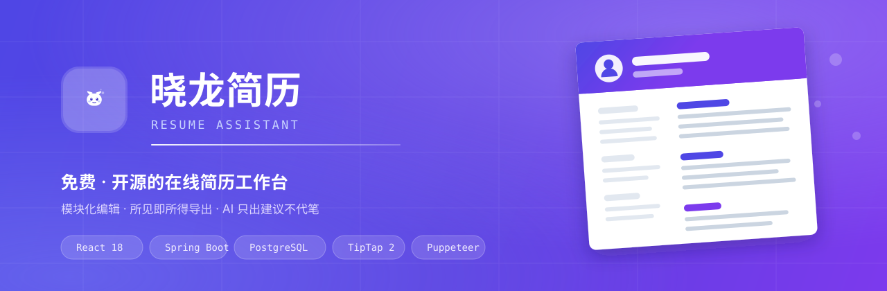
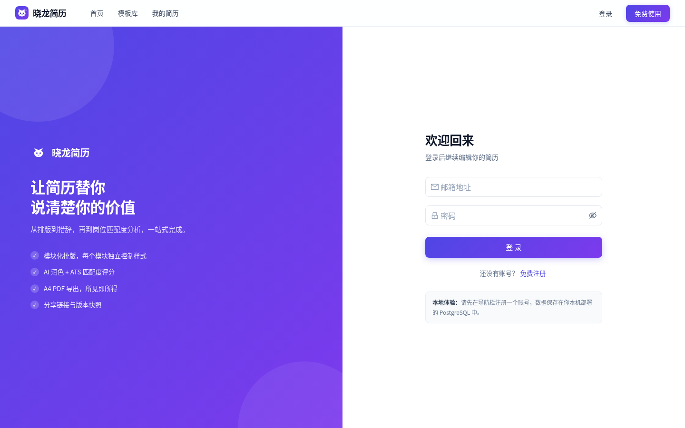
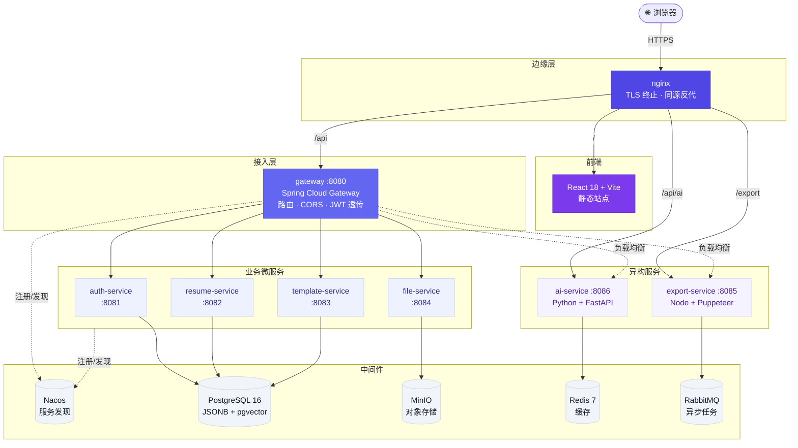
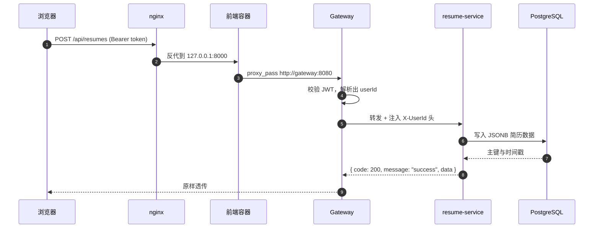

<div align="center">



<br>

**免费 · 开源的在线简历工作台**
模块化编辑 · 所见即所得导出 · AI 只出建议、不代笔

<br>

[](./DEPLOY.md)
[](./LICENSE)
[](https://github.com/ZxlDragonDoctor/resume-assiatant/releases)
[](https://github.com/ZxlDragonDoctor/resume-assiatant/pulls)

[](https://openjdk.org/)
[](https://spring.io/projects/spring-boot)
[](https://github.com/alibaba/spring-cloud-alibaba)
[](https://react.dev/)
[](https://www.typescriptlang.org/)

[](https://www.postgresql.org/)
[](https://fastapi.tiangolo.com/)
[](https://pptr.dev/)
[](./docker-compose.yml)
[](https://nginx.org/)

<br>

[**在线体验**](https://www.zxldragon.fun) · [快速开始](#-快速开始) · [架构设计](#-架构设计) · [API 文档](#-api) · [部署指南](./DEPLOY.md) · [前端规范](./docs/FRONTEND.md)

</div>

---

<br>

<div align="center">

### 写出让 HR 多看两眼的那份简历

从空白页到一份可直接投递的 A4 PDF，全程可视化。
**编辑、预览、导出走同一套渲染规则** —— 你在屏幕上看到的排版，就是 HR 收到的那份。

<br>


<sub>▲ 首页：实时简历预览 + AI 优化提示，所见即所得</sub>

</div>

<br>

## ✨ 特性

<table>
<tr>
<td width="50%" valign="top">

### 📐 模块化编辑
10 种内容模块（基本信息 / 个人总结 / 实习 / 工作 / 项目 / 教育 / 技能 / 奖项 / 证书 / 自定义），
基于 `@dnd-kit` 自由拖拽排序，支持显隐与复制。

### 🎨 三级样式覆盖
`模板默认` < `全局布局` < `模块级配置`。
每个模块可独立设置标题样式（下划线 / 色条 / 胶囊 / 实底 / 无）、字号、颜色、行距与对齐。

### ✍️ 双模富文本
每个长文本模块可在 **Markdown** 与 **富文本** 之间一键切换，
预览与导出同时支持 HTML / Markdown / 纯文本三态渲染。

</td>
<td width="50%" valign="top">

### 🖨️ 所见即所得导出
Puppeteer 无头 Chrome 渲染 A4 PDF（794 × 1123 px），
**与编辑器预览共用同一套排版规则**，并有一份 14 项断言的渲染契约测试守着两者不跑偏。

### 🤖 AI 助手（可离线降级）
内容润色、个人总结、ATS 体检、JD 解析、面试题预测、技能匹配共 6 项能力。
**未配置任何大模型密钥时自动降级为本地规则引擎**，功能不中断、页面不报错。

### 🕓 版本管理与只读分享
手动存档、时间线回溯、一键回退；
生成随机令牌链接，HR 无需登录即可查看，且内容实时同步。

</td>
</tr>
</table>

<br>

## 🖼 界面预览

<div align="center">




<sub>▲ 登录（品牌色全屏） · 工作台（实时预览）</sub>

</div>

<br>

## 🏗 架构设计

<br>

<div align="center">

**13 个容器** · 5 个 Java 微服务 · 3 个异构应用服务 · 5 个中间件 · 单域名同源

</div>

<br>



### 一次请求的完整链路



> **关键设计**：网关在转发时把 JWT 里的 `userId` 解析出来，以
> `X-UserId` 请求头传给下游。微服务只需 `@RequestAttribute UUID userId`
> 即可拿到当前用户，不必各自解析 token。

<br>

## 🚀 快速开始

### 前置要求

`Node.js 18+` · `JDK 17+` · `Maven 3.8+` · `Docker` · `Python 3.11+`

<br>

### 方式一：只起基础设施（日常开发，推荐）

保留热重载，改代码即时生效：

```bash
# 只启动 PostgreSQL / Nacos / MinIO
docker compose up -d postgres nacos minio
```

然后按下方「本地开发」分别启动各服务。

> **当前 Java 服务只依赖 PostgreSQL / Nacos / MinIO 三者**
> —— JSONB 简历数据、服务注册、模板与文件存储都已覆盖。
> Redis 与 RabbitMQ 是为后续异步任务预留的。

<br>

### 方式二：一键起全栈（容器部署）

```bash
export OPENAI_API_KEY=sk-你的密钥   # 可选，不填则走本地规则引擎
docker compose up -d --build
```

构建并启动**全部 13 个服务**，访问 <http://localhost:8000>。
首次构建需下载依赖，耗时较长。

> 完整的部署说明、免费托管方案与安全清单见 **[DEPLOY.md](./DEPLOY.md)**。
> 国内服务器构建请务必先读其中的「国内服务器构建必读」一节。

<br>

### 本地开发

<details>
<summary><b>1. Java 后端</b>（点击展开）</summary>

```bash
# 必须先构建 common —— 其它服务把它当作兄弟模块依赖
mvn clean install -pl services/common -am -DskipTests

# 按顺序启动（Nacos 必须先在）
mvn spring-boot:run -pl services/gateway
mvn spring-boot:run -pl services/auth-service
mvn spring-boot:run -pl services/resume-service
mvn spring-boot:run -pl services/template-service
mvn spring-boot:run -pl services/file-service
```

</details>

<details>
<summary><b>2. AI 服务</b>（点击展开）</summary>

```bash
cd ai-service
pip install -r requirements.txt
cp .env.example .env        # 可选：填入大模型密钥
uvicorn app.main:app --reload --port 8086
```

> **无需密钥即可运行** —— 未配置时自动使用本地规则引擎，所有 AI 功能依然可用，
> 响应中的 `engine` 字段会标记为 `rule`。

**切换大模型厂商**只需改 `.env` 三个变量，零代码改动：

| 厂商 | `OPENAI_BASE_URL` | `LLM_MODEL` |
|---|---|---|
| 通义千问（默认） | `https://dashscope.aliyuncs.com/compatible-mode/v1` | `qwen-max` |
| DeepSeek | `https://api.deepseek.com/v1` | `deepseek-chat` |
| OpenAI | `https://api.openai.com/v1` | `gpt-4o-mini` |

千问可选：`qwen3-max`（旗舰）> `qwen-max`（默认）> `qwen-plus`（均衡）> `qwen-turbo`（最快）。
Key 在[阿里云百炼控制台](https://bailian.console.aliyun.com/)申请。

</details>

<details>
<summary><b>3. 导出服务</b>（点击展开）</summary>

```bash
cd export-service
npm install                 # 会自动下载 Chromium
npm run dev
```

> 若跳过 Chromium 下载（如 `PUPPETEER_SKIP_DOWNLOAD=true`），
> 需手动安装：`npx puppeteer browsers install chrome`。
> 未安装时导出接口返回 `Could not find Chrome`。

</details>

<details>
<summary><b>4. 前端</b>（点击展开）</summary>

```bash
cd frontend
npm install
npm run dev
```

打开 <http://localhost:5173> 即可。

</details>

<br>

### 就绪自检

```bash
# 基础设施（两个都应返回 200）
curl -o /dev/null -w "%{http_code}\n" http://localhost:4348/nacos/
curl -o /dev/null -w "%{http_code}\n" http://localhost:9100/minio/health/live

# 网关注册的微服务列表（应为 5 个）
curl -s "http://localhost:4348/nacos/v1/ns/service/list?pageNo=1&pageSize=50"
```

> **端口非默认值说明**：Nacos 为 `4348`（映射 `4348:8848`），
> MinIO 为 `9100/9101` —— 都是为避开本机已占用的端口而改。
> 详见下方「服务端口」。

<br>

## 📦 技术栈

<table>
<tr><th align="left">分层</th><th align="left">技术选型</th></tr>
<tr><td><b>前端</b></td><td>
<code>React 18</code> <code>TypeScript 5</code> <code>Vite 5</code> <code>Ant Design 5</code>
<code>Zustand</code> <code>TipTap 2</code> <code>@dnd-kit</code>
</td></tr>
<tr><td><b>后端</b></td><td>
<code>Java 17</code> <code>Spring Boot 3.2.5</code> <code>Spring Cloud Alibaba 2023.0.1.0</code>
<code>MyBatis-Plus 3.5.7</code>
</td></tr>
<tr><td><b>数据</b></td><td>
<code>PostgreSQL 16</code> <code>JSONB</code> <code>pgvector</code> <code>Redis 7</code>
<code>MinIO</code>
</td></tr>
<tr><td><b>基础设施</b></td><td>
<code>Nacos</code> <code>RabbitMQ 3.13</code> <code>Docker Compose</code> <code>Nginx</code>
</td></tr>
<tr><td><b>智能与导出</b></td><td>
<code>Python 3.11+</code> <code>FastAPI</code> <code>LangChain 0.2</code>
<code>Node.js</code> <code>Express</code> <code>Puppeteer 22</code>
</td></tr>
</table>

<br>

## 📁 项目结构

```
ResumeAssistant/
├── services/                       # Java 微服务
│   ├── common/                     #   共享 DTO、R<T>、异常处理
│   ├── gateway/                    #   Spring Cloud Gateway（:8080）
│   ├── auth-service/               #   JWT 认证（:8081）
│   ├── resume-service/             #   简历 CRUD + JSONB（:8082）
│   ├── template-service/           #   模板管理（:8083）
│   └── file-service/               #   MinIO 文件上传（:8084）
├── export-service/                 # Node.js PDF 导出（:8085）
│   ├── src/renderer.js             #   渲染器（与前端预览引擎规则镜像）
│   └── scripts/contract-test.mjs   #   渲染契约测试（14 项断言）
├── ai-service/                     # Python FastAPI AI（:8086）
│   ├── app/services/ai_service.py  #   LLM 优先
│   ├── app/services/rule_engine.py #   本地规则降级
│   └── scripts/rule_engine_test.py #   降级测试（6 项）
├── frontend/                       # React 前端（:5173）
│   └── src/
│       ├── components/
│       │   ├── editor/             #   编辑器组件（受控，不直接读写 store）
│       │   ├── viewer/             #   渲染引擎 + 富文本
│       │   ├── dashboard/          #   工作台组件
│       │   ├── templates/          #   模板预览
│       │   ├── layout/             #   全局外壳
│       │   └── common/             #   通用原子组件
│       ├── pages/                  #   Home / Login / Dashboard / Editor / Templates / Profile / SharedResume
│       ├── services/api.ts         #   Axios 封装 + 全部接口
│       ├── stores/                 #   resumeStore / authStore
│       ├── styles/                 #   tokens.ts（设计令牌唯一来源）+ global.css
│       ├── constants/sections.ts   #   模块元数据
│       └── types/resume.ts         #   领域模型
├── docs/
│   ├── FRONTEND.md                 # 前端设计系统规范
│   ├── assets/                     # README 视觉资源（banner / 截图）
│   ├── conf/rabbitmq.conf          # 低内存服务器的 RabbitMQ 配置
│   └── sql/init.sql                # 建表 + 触发器 + 6 个种子模板
├── docker-compose.yml              # 全栈编排
├── docker-compose.server.yml       # 低内存服务器覆盖层
└── DEPLOY.md                       # 部署指南
```

<br>

## 🔌 服务端口

| 服务 | 端口 | 说明 |
|---|---|---|
| Gateway | `8080` | 前端统一入口 |
| auth-service | `8081` | JWT 认证 |
| resume-service | `8082` | 简历 CRUD |
| template-service | `8083` | 模板管理 |
| file-service | `8084` | 文件上传 |
| export-service | `8085` | PDF 导出 |
| ai-service | `8086` | AI 能力 |
| frontend (Vite) | `5173` | 开发服务器 |
| frontend (容器) | `8000` | nginx 托管 |
| Nacos | **`4348`** | 映射 `4348:8848`，控制台 `/nacos` |
| PostgreSQL | `5432` | — |
| MinIO API / 控制台 | **`9100`** / **`9101`** | 避免与本机其它实例冲突 |
| Redis / RabbitMQ | `6379` / `5672` | — |

> ⚠️ **改 MinIO 端口时必须同步两处**：`docker-compose.yml` 的 minio `ports`
> 与 `services/file-service/src/main/resources/application.yml` 的 `minio.endpoint`。
> 两处不一致会导致头像/附件上传失败。

Vite 已配置代理：`/api` → `http://localhost:8080`，`/export` → `http://localhost:8085`。

<br>

## 📡 API

网关统一入口 `http://localhost:8080`，响应格式 `{ code, message, data }`。

| 端点 | 服务 | 说明 |
|---|---|---|
| `POST /api/auth/register` `/login` | auth | **公开** |
| `GET/PATCH /api/auth/me` | auth | 资料读写 |
| `POST /api/auth/change-password` | auth | 修改密码 |
| `/api/resumes/**` | resume | 简历 CRUD、模块、排序、版本、统计 |
| `POST /api/resumes/{id}/share` | resume | 开启分享（返回 token） |
| `GET /api/public/resumes/{token}` | resume | **公开**，只读分享 |
| `/api/templates/**` | template | 模板列表 / 分类 / 详情 |
| `/api/files/**` | file | 文件上传、头像 |
| `/api/ai/**` | ai | 6 项 AI 能力 |
| `/api/export/**` | export | PDF 导出 |

除注册、登录、`/api/public/**` 外，均需 `Authorization: Bearer <token>`。

### AI 能力一览

| 能力 | 端点 | 引擎 |
|---|---|---|
| 要点润色 | `/api/ai/optimize-bullet` | 大模型 |
| 个人总结 | `/api/ai/generate-summary` | 大模型 |
| ATS 评分 | `/api/ai/ats-score` | 大模型 |
| JD 解析 | `/api/ai/parse-jd` | 大模型 |
| 面试题预测 | `/api/ai/interview-questions` | 大模型 |
| 简历翻译 | `/api/ai/translate` | 大模型 |
| 技能匹配 | `/api/ai/match-skills` | **纯规则**（精确匹配，更快更稳） |

除技能匹配外，其余能力调用失败时都会自动降级到本地规则引擎。
响应中的 `engine` 字段标识实际使用的引擎：`llm` / `rule` / `none`。

<br>

## 🧪 测试

```bash
# 渲染契约测试（14 项）—— 保证 PDF 与预览完全一致
cd export-service && npm run test:contract

# AI 规则引擎降级测试（6 项）—— 保证无密钥时功能可用
cd ai-service && python scripts/rule_engine_test.py

# 前端类型检查 + 生产构建
cd frontend && npm run build
```

> **修改任一渲染器后，务必运行契约测试。**
> 详见 [docs/FRONTEND.md](./docs/FRONTEND.md) 的「渲染契约」一节。

<br>

## 🗄 数据库

PostgreSQL，默认连接 `resume / resume123 @ localhost:5432/resume_assistant`。

| 表 | 说明 |
|---|---|
| `users` | 账号 |
| `resumes` | 简历主表（含 `share_token` / `share_enabled` / `view_count` / `status`） |
| `resume_sections` | 模块内容，`data` 为 JSONB（业务字段 + `_config` 样式），带 GIN 索引 |
| `resume_versions` | 版本快照 |
| `templates` | 模板 |
| `ai_operations` | AI 调用审计 |

`docs/sql/init.sql` 含建表语句、触发器与 6 个种子模板。

<br>

## 📐 开发约定

| 约定 | 说明 |
|---|---|
| **设计令牌单一来源** | `frontend/src/styles/tokens.ts`，组件内不写魔法色值 |
| **渲染器必须同步** | `ResumePreviewEngine.tsx` ↔ `export-service/src/renderer.js` |
| **编辑器单一编排者** | `pages/Editor.tsx` 是唯一读写 `resumeStore` 的地方 |
| **`_config` 不可丢失** | 内容编辑不得覆盖模块样式配置 |
| **A4 尺寸固定** | 794 × 1123 px，缩放只作用于 `transform: scale()` |
| **UUID 主键** | 全表使用 MyBatis-Plus `ASSIGN_UUID` |

完整前端规范见 [docs/FRONTEND.md](./docs/FRONTEND.md)。

<br>

## 🤝 贡献

欢迎提交 Issue 与 Pull Request。

```bash
git clone https://github.com/ZxlDragonDoctor/resume-assiatant.git
cd ResumeAssistant
git checkout -b feat/your-feature
```

1. 改动渲染器请**同时**修改前端预览与导出渲染器，并跑通契约测试
2. 新增颜色请先判断归属：**UI 语义色** → `tokens.ts` 令牌；**用户可选色** → 调色板
3. 提交前请确保 `cd frontend && npm run build` 通过

<br>

## 📄 License

以 [MIT](./LICENSE) 协议开源。

<div align="center">
<br>

**[⬆ 回到顶部](#)**

<sub>Made with ❤️ for job seekers</sub>

</div>
